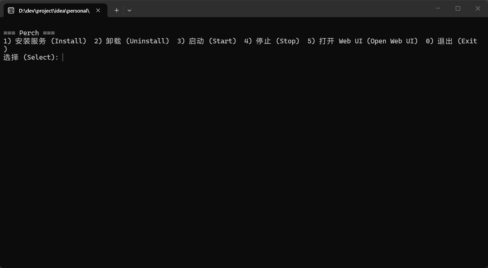
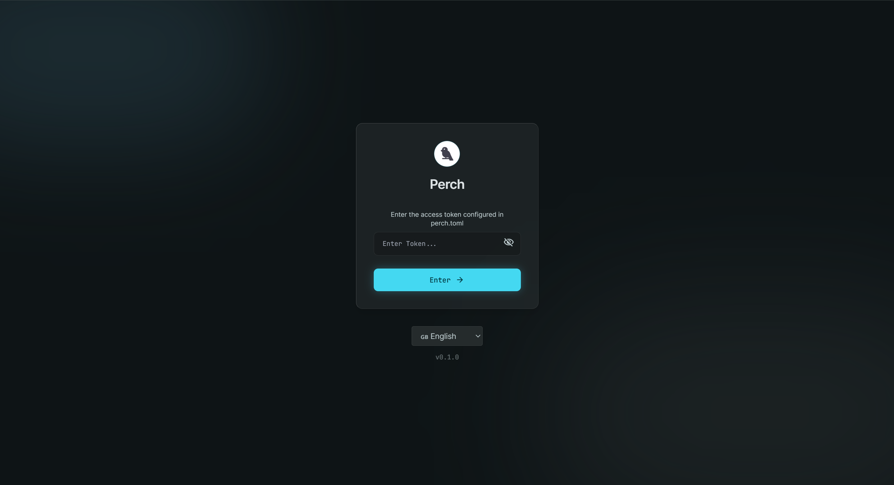
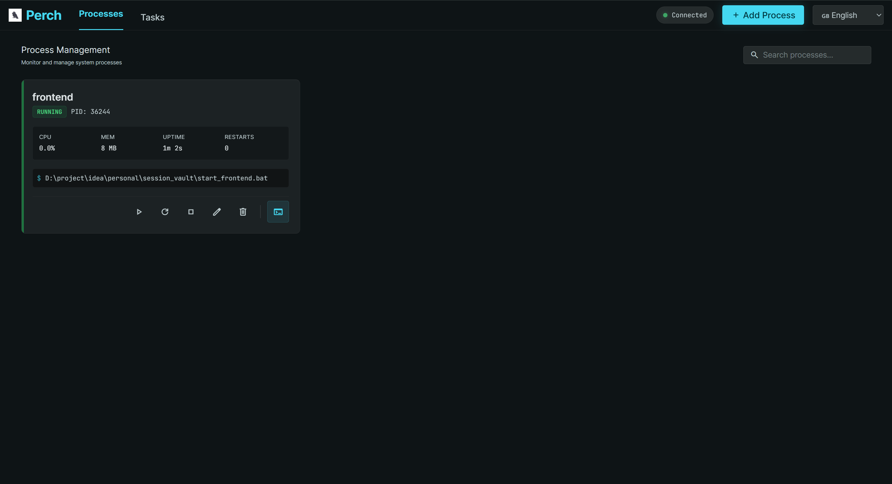
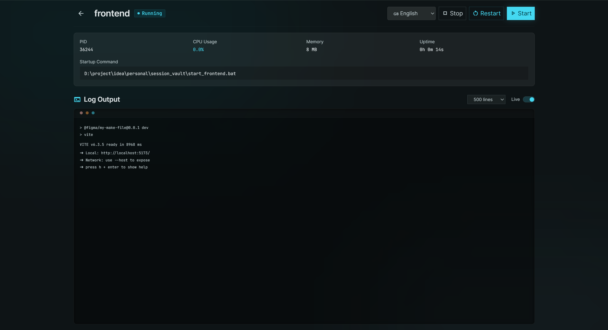
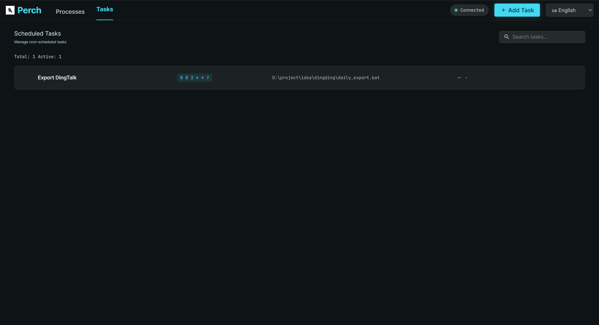

<div align="center">
<sub>🇬🇧 <a href="./README.md">English</a> &nbsp;|&nbsp; 🇨🇳 <a href="./README.zh-CN.md">中文</a> &nbsp;|&nbsp; 🇪🇸 <a href="./README.es.md">Español</a> &nbsp;|&nbsp; 🇯🇵 <a href="./README.ja.md">日本語</a> &nbsp;|&nbsp; 🇧🇷 <a href="./README.pt.md">Português</a></sub>
</div>

<br/>

<div align="center">


# Perch

**Un gestor de procesos y servicios para Windows, ligero y de un solo binario, con web UI integrada.**

Escrito en Rust. Sin dependencias de runtime. Un binario, doble clic y listo.

</div>

---

## Capturas de pantalla

> Coloca los archivos de captura en las rutas siguientes (ver [Archivos de captura de pantalla a proporcionar](#archivos-de-captura-de-pantalla-a-proporcionar)).

### Menú interactivo (doble clic en `perch.exe`)



### Inicio de sesión



### Panel de procesos



### Detalle del proceso — Transmisión de logs en vivo



### Tareas programadas



---

## ¿Por qué Perch?

Gestionar procesos en segundo plano y servicios de larga duración en Windows es más difícil de lo que debería ser:

- **Task Scheduler** termina por defecto los procesos de larga duración (tiempos de espera de sesión, terminación del árbol de procesos, dependencias de la sesión de inicio) — nunca fue diseñado para daemons.
- **NSSM / WinSw / Shawl** son un wrapper por servicio. Sin panel, sin vista central, hay que registrar N veces.
- **PM2** necesita un runtime de Node.js, su daemon inactivo consume 40–80 MB, y es un ciudadano de segunda clase en Windows (inicio poco fiable, parches en el registro).
- **Supervisor** ni siquiera funciona en Windows.

Perch llena ese vacío: **registrar una vez, gestionar todo.** Un único servicio nativo supervisa todos tus procesos, expone una web UI y se mantiene fuera del camino.

## Características

- **Binario único** — sin runtime, sin dependencias. La web UI está incrustada directamente en el ejecutable.
- **Servicio nativo de Windows** — se registra una vez, arranca con el sistema, sobrevive al cierre de sesión, se ejecuta en Session 0.
- **Bajo consumo** — compilado en Rust, un único proceso supervisor. Objetivo de 5–15 MB de memoria residente.
- **Web UI integrada** — ver el estado, iniciar/detener/reiniciar procesos y seguir los logs desde el navegador. Gestiona de forma remota, no solo desde la consola.
- **Reinicio automático** — los procesos que fallan se reinician solos, con retroceso configurable.
- **Tareas programadas** — planificación estilo cron para trabajos periódicos.
- **Rotación diaria de logs** — los logs de la aplicación se escriben en `logs/perch.YYYY-MM-DD.log` junto al ejecutable, en formato delimitado por pipes.
- **Menú interactivo** — doble clic en el exe para instalar/desinstalar/iniciar/detener el servicio y abrir la web UI, con elevación UAC bajo demanda.

## Estado

> ⚠️ **Desarrollo temprano.** Perch está en construcción activa y aún no está listo para producción. Las interfaces y la configuración pueden cambiar.

## Inicio rápido

Doble clic en `perch.exe` y selecciona `5) Open Web UI (Abrir Web UI)` en el menú — Perch generará automáticamente un `perch.toml` por defecto (con un proceso `demo` y el token `change-me`) e iniciará el servidor.

O desde la línea de comandos:

```
# Ejecutar en primer plano (Ctrl-C para detener)
perch run

# Registrar Perch como servicio de Windows (necesita admin)
perch install
perch start

# Abrir la web UI
http://127.0.0.1:9000
```

El token por defecto es `change-me` — cámbialo en `perch.toml` antes de cualquier uso real.

## Seguridad

El endpoint de gestión puede iniciar y detener procesos arbitrarios — tiene **privilegios muy altos**. Perch se vincula a `127.0.0.1` por defecto y requiere un token de acceso. No expongas el puerto de gestión a redes no fiables.

## Comparación

| | Perch | NSSM / WinSw | PM2 | Supervisor |
|---|:---:|:---:|:---:|:---:|
| Binario único | ✅ | ✅ | ❌ (necesita Node) | ❌ (necesita Python) |
| Gestiona muchos procesos desde una instancia | ✅ | ❌ (1 por servicio) | ✅ | ✅ |
| Web UI integrada | ✅ | ❌ | ✅ | ✅ |
| Servicio nativo de Windows | ✅ | ✅ | ⚠️ | ❌ |
| Tareas programadas | ✅ | ❌ | ✅ | ⚠️ |
| Rotación diaria de logs | ✅ | ❌ | ⚠️ | ⚠️ |
| Bajo consumo de memoria | ✅ | ✅ | ❌ | ⚠️ |

## Compilar desde el código fuente

```
cargo build --release
```

Requiere una toolchain estable de Rust reciente.

## Archivos de captura de pantalla a proporcionar

Coloca los archivos de captura en `docs/screenshots/` (crea el directorio primero), usando estos nombres exactos:

| Ruta | Qué capturar |
|---|---|
| `docs/screenshots/menu.png` | Ventana de consola tras hacer doble clic en `perch.exe`, mostrando el menú bilingüe (Instalar/Desinstalar/Iniciar/Detener/Abrir Web UI/Salir). |
| `docs/screenshots/login.png` | Página de inicio de sesión de `http://127.0.0.1:9000/` con el logo de Perch y el campo de token. |
| `docs/screenshots/processes.png` | Panel de `/processes` con la tarjeta `demo` mostrando el estado Running y la barra de navegación superior con el logo. |
| `docs/screenshots/process-detail.png` | Página `/process-detail?name=demo` con el panel PID/CPU/Mem/Tiempo de actividad y el flujo de logs en vivo. |
| `docs/screenshots/tasks.png` | Página `/tasks` con al menos una fila de tarea programada, barra de navegación superior con el logo. |

Consejo: captura con un viewport de 1280×800; usa PNG; recorta los bordes del navegador. Una vez colocados los archivos, las referencias de imagen de arriba se renderizarán automáticamente.

## Licencia

Por determinar
